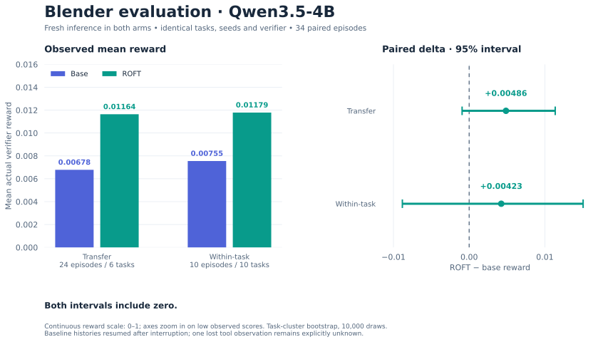
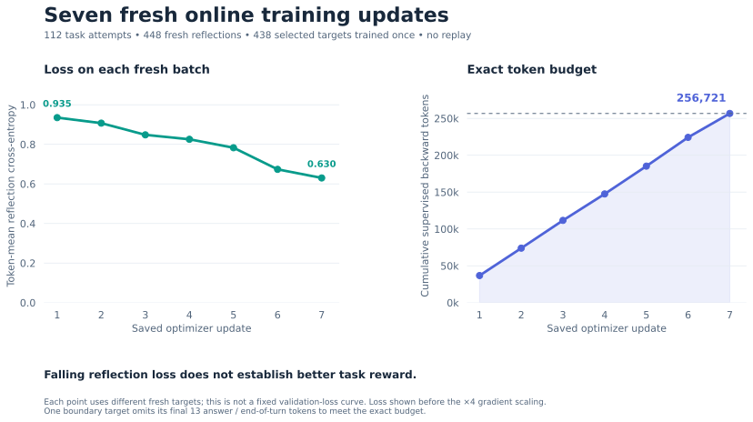
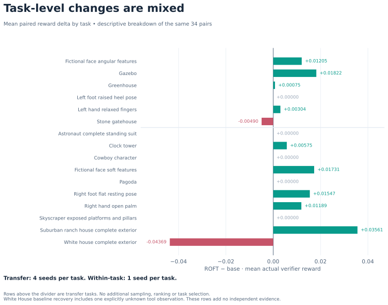

# ROFT in PyTorch

A local implementation of **retrospection-only fine-tuning (ROFT)** from [Shockingly Simple Self-retrospection Improves Agentic Models Without RL](https://arxiv.org/abs/2609.35741v1), tested on agentic Blender tasks using Qwen3.5-4B and one H100.

The learner attempts tasks, receives actual verifier feedback, writes four fresh reflections, and learns from those reflections. New attempts and reflections use the updated model after each optimizer update. Reflections are not replayed.

```text
current model ──► Blender attempt ──► actual execution + verifier feedback
      │                                      │
      └────────────► four fresh reflections ◄┘
                               │
                     token-averaged reflection CE
                               │
                  backward + full-parameter AdamW
                               │
                         updated model
                               └──► next fresh cycle
```

This is **not the official authors' trainer** and is not an exact replication of their coding benchmark. The reported experiment trained **Qwen3.5-4B**, not Qwen3.8-27B. No 27B ROFT result is claimed.

## Results

Seven full-parameter updates used **exactly 256,721 backward tokens**, 112 fresh attempts and 448 fresh reflections. Of these, 438 targets were trained once, with one final boundary target partially supervised to meet the exact budget. All seven full FP32 model/Adam/RNG states and fresh serving reloads passed numerical audits.

Both arms used fresh inference on the same frozen 34 episodes, prompts, seeds, budgets and verifiers. Interrupted baseline histories resumed their original containers and next seeds.

| Arm | Provenance | Backward tokens | Transfer reward (24 episodes) | Within-task reward (10 episodes) |
|---|---|---:|---:|---:|
| Base Qwen3.5-4B | Fresh inference; interrupted histories resumed | 0 | 0.0067806 | 0.0075516 |
| ROFT Qwen3.5-4B | Fresh inference | 256,721 | 0.0116385 | 0.0117857 |

| ROFT minus base | Mean reward delta | 95% task-cluster bootstrap interval |
|---|---:|---|
| Transfer | +0.0048579 | [-0.0009334, +0.0113663] |
| Within-task | +0.0042341 | [-0.0088239, +0.0150513] |

**Both intervals include zero.** Absolute rewards are low; this small run does not establish reliable improvement or the paper's training-time advantage. Rewards are continuous outputs of the actual Blender verifiers, not coding pass rates. Earlier GRPO results are historical and are not substituted for a fresh arm.





<details>
<summary>View changes for every evaluation task</summary>



</details>

Figures use the published numeric records only. [SVG and PNG downloads](assets/figures/) and [the plotting script](tools/plot_results.py) are included; regenerate with `python3 tools/plot_results.py` after installing `requirements-dev.txt`.

[Results and limitations](docs/RESULTS_REVIEW.md) · [Per-task results](docs/PER_TASK_RESULTS.md) · [Paper comparison](docs/METHODOLOGY_COMPARISON.md)

## Code and usage

- [`code/train.py`](code/train.py): native full-model FP32 gradient accumulation, BF16 forward compute, CPU AdamW, exact state restore and serving reload audit.
- [`code/worker.py`](code/worker.py): fresh attempt/reflection cycles, exact token budget, saved-state recovery and paired evaluation.
- [`code/generate.py`](code/generate.py) and [`code/agent_env.py`](code/agent_env.py): vLLM native tool generation and persistent Blender containers.
- [`code/reflection_targets.py`](code/reflection_targets.py) and [`code/token_budget.py`](code/token_budget.py): paper preprocessing and auditable whole-target selection with one boundary prefix.
- [`code/audits/`](code/audits): numerical, provenance, reward, state and raw-byte audits.

Read [SETUP.md](SETUP.md) for runtime/data preparation. The benchmark task assets, published verifier package, raw trajectories and model checkpoints are retained separately. This repository contains the implementation, compact numeric results, checkpoint metadata and evidence hashes; it is not a dataset release.

Verify the public numeric results without a GPU or credentials:

```bash
python3 tools/verify_results.py
```

With PyTorch installed, run the CPU methodology checks:

```bash
cd code
python3 -m unittest test_methodology -v
```

## Methodology and evidence

The paper optimizer recipe is AdamW with lr=1e-6, betas=(0.9, 0.98), eps=1e-8, weight decay=0.1, reflection token-mean CE scaled by 4, and gradient clipping at 1. All model parameters are trained. There is no ROFT policy-gradient reward loss, KL penalty or entropy term.

Remaining adaptations include a 72-task Blender training pool, 16 attempts ×4 reflections per cycle, single-H100/CPU Adam and serialized phases, two original images plus candidate-feedback images, and continuous geometry/visual rewards. One final target omits its last 13 answer/EOT tokens to meet the fixed budget. A uniform qualified malformed-topology guard uses the verifier's existing invalid-model path for both evaluation arms. One baseline White House tool observation was lost during a supervisor interruption: its exit status/stdout/stderr remain explicitly unknown; the action was not repeated.

The completed run passed all **17 combined audit requirements**. Full final weights and the 50 GB master/Adam/RNG archive were backed up and independently SHA-verified. All **66,896 original evidence files**, totaling **56.3 GB of recovered bytes**, passed current direct or reversible-compressed storage checks. Public receipts summarize these checks; hashes cannot reproduce or independently validate unpublished raw trajectories by themselves.

[Full alignment](docs/METHODOLOGY_ALIGNMENT.md) · [Combined audit receipt](results/audits/current_goal_completion_audit.json) · [Current raw-byte receipt](results/audits/local_raw_storage_audit.json) · [Export provenance](results/public_export.json)

Public copies replace operational host paths and cloud identifiers with placeholders and use environment-based credential/transport settings. The original frozen experiment files remain unchanged; original source hashes are recorded in the export manifest. Local code is MIT-licensed; imported author reference and paper assets retain their own notices.


## Paper citation

Jonathan Light, Christopher Zhang Cui, Jeonghye Kim, Roger Creus Castanyer, Emiliano Penaloza, Zhengyan Shi, Alessandro Sordoni, Marc-Alexandre Côté, Xingdi Yuan, and Minseon Kim. **Shockingly Simple Self-retrospection Improves Agentic Models Without RL.** arXiv:2609.35741v1, 2026. [Read the paper](https://arxiv.org/abs/2609.35741v1).

This repository implements and adapts the paper's method; its Blender results are a separate local experiment. Please credit the original authors when using the method. [BibTeX citation](CITATION.bib):

```bibtex
@misc{light2026selfretrospection,
  title         = {Shockingly Simple Self-retrospection Improves Agentic Models Without RL},
  author        = {Jonathan Light and Christopher Zhang Cui and Jeonghye Kim and Roger Creus Castanyer and Emiliano Penaloza and Zhengyan Shi and Alessandro Sordoni and Marc-Alexandre C{\^o}t{\'e} and Xingdi Yuan and Minseon Kim},
  year          = {2026},
  eprint        = {2609.35741},
  archivePrefix = {arXiv},
  primaryClass  = {cs.AI},
  url           = {https://arxiv.org/abs/2609.35741v1},
  note          = {Version 1}
}
```
